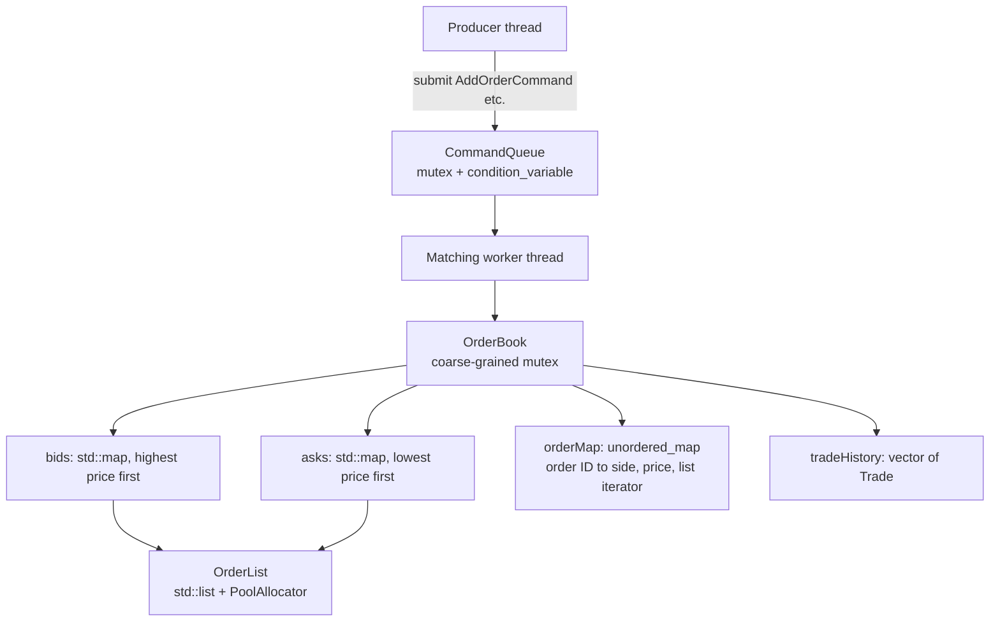

# Limit Order Book and Matching Engine (C++17)

A limit order book with price-time priority, profile-driven single-threaded optimization, and a multithreaded command engine. The project measures its design choices instead of assuming them, and one of its findings is that adding a thread made it **slower**.

**Branches:** `main` (this branch) has the multithreaded engine and queue experiments. [`single-threaded-baseline`](../../tree/single-threaded-baseline) has the single-threaded optimization history, Instruments profiling notes, and the standard-allocation baseline.

## Key findings

- Profile-driven changes took the single-threaded book from **4.38-4.77M** to **8.06-8.40M orders/s** (about 1.77x) on the same workload and flags. Details are on the baseline branch and summarized below.
- The multithreaded engine (producer, queue, matching worker) reached **4.67-4.70M orders/s**, about **1.67x slower** than calling the book directly (**7.82-7.84M orders/s**). Handing each command across threads cost more than it saved.
- In a 3-producer comparison, a lock-free linked MPSC queue was about **1.4x slower** than a mutex-protected queue (5.46M vs 7.77M orders/s, mean over 3 invocations).
- 33 tests pass in Release and under ThreadSanitizer and AddressSanitizer/UBSan.

## Results at a glance

All numbers: 10,000 orders per run, 3 warm-up runs, 1,000 measured runs per invocation, 3 invocations, seed 42, price range 90.00-110.00 in 0.01 ticks, 7,750 trades per run. Times are per **10,000-order batch**, not per order.

| Configuration | Throughput (range over 3 invocations) | Mean per batch | P50 | P99 | P99.9 |
|---|---:|---:|---:|---:|---:|
| `OrderBook` called directly (single-threaded) | 7.82-7.84M orders/s | 1.275-1.280 ms | 1.268-1.270 ms | 1.347-1.475 ms | 1.603-2.167 ms |
| `MatchingEngine` (1 producer, queue, 1 worker) | 4.67-4.70M orders/s | 2.126-2.140 ms | 2.118-2.132 ms | 2.199-2.381 ms | 2.522-3.012 ms |

The engine timing includes `engine.stop()` (drain the queue and join the worker), so it measures end-to-end work including shutdown.

**Environment:** Apple M2 MacBook Air (8 GB, fanless), macOS 26.0.1, AppleClang 17.0.0 (arm64), CMake Release with `-O2 -DNDEBUG`. Invocations were separated by 60-second pauses. Thermal state was not recorded, so absolute numbers may vary on other hardware.

## Demo

```bash
./build-release/main
```

The demo runs a short scripted scenario: resting sells at two price levels, a buy that crosses FIFO at one level and partially fills the next, a buy that sweeps two levels and rests, an exact-price match, and a cancel. It prints the new trades and the book after each step.

```text
=== Step 1: three resting SELLs (#1 10@101, #2 5@101 later, #3 8@102) ===
  (no trades)

========== ORDER BOOK ==========

-- ASKS (SELL) --
101 : 2 order(s)
  ID: 1, Quantity: 10
  ID: 2, Quantity: 5
102 : 1 order(s)
  ID: 3, Quantity: 8

-- BIDS (BUY) --

===============================

=== Step 2: BUY #4 12@101.50 (crosses #1 fully, then #2 partially, FIFO) ===
  TRADE: buy #4 / sell #1  10 @ 101
  TRADE: buy #4 / sell #2  2 @ 101

========== ORDER BOOK ==========

-- ASKS (SELL) --
101 : 1 order(s)
  ID: 2, Quantity: 3
102 : 1 order(s)
  ID: 3, Quantity: 8

-- BIDS (BUY) --

===============================

=== Step 3: BUY #5 20@103 (sweeps two price levels, remainder rests) ===
  TRADE: buy #5 / sell #2  3 @ 101
  TRADE: buy #5 / sell #3  8 @ 102

========== ORDER BOOK ==========

-- ASKS (SELL) --

-- BIDS (BUY) --
103 : 1 order(s)
  ID: 5, Quantity: 9

===============================

=== Step 4: SELL #6 4@103 (hits the resting bid at an exact price) ===
  TRADE: buy #5 / sell #6  4 @ 103

========== ORDER BOOK ==========

-- ASKS (SELL) --

-- BIDS (BUY) --
103 : 1 order(s)
  ID: 5, Quantity: 5

===============================

=== Step 5: cancel #5 ===
  (no trades)

========== ORDER BOOK ==========

-- ASKS (SELL) --

-- BIDS (BUY) --

===============================
```

Things to notice: trades execute at the **resting** order's price (step 2 buys at 101 although the bid was 101.50); orders at the same price fill in arrival order (#1 before #2); step 3 sweeps two price levels and rests the remainder; and the cancel in step 5 empties the book.

## Architecture



**Components**

- `OrderBook`: price levels, FIFO order lists, an order-ID index, and trade history. Mutating operations are protected by one mutex (the exception, `getTradeHistory()`, is noted under Limitations).
- `CommandQueue`: a mutex plus condition-variable queue of commands. It can be closed so a blocked consumer wakes up and shuts down cleanly.
- `MatchingEngine`: owns a `CommandQueue`, an `OrderBook`, and one worker thread that applies commands in order.
- Commands (`std::variant`): `AddOrderCommand`, `CancelOrderCommand`, `ModifyOrderCommand`, `QueryHasOrderCommand`, `QueryOrderQuantityCommand`. The query commands carry a `std::promise` so callers get a result back from the worker.

**Queue experiments (not part of the engine path).** `LockFreeMSQueue.h` (a linked, Michael-Scott-style MPSC queue) and `lockFreeMPSCqueue.h` (an atomic MPSC queue) are tested and benchmarked against a mutex-protected polling queue. The engine itself uses the mutex and condition-variable `CommandQueue`.

## Design decisions and trade-offs

| Choice | Why | Cost |
|---|---|---|
| `std::map` for price levels | Ordered, so best bid and ask are O(1) at the ends; insert and erase are O(log P) | Tree nodes, pointer chasing, allocation; red-black rebalancing shows up in profiles (about 6.6% sampled time) |
| `std::list` per price level | A stored iterator gives O(1) removal anywhere in the FIFO, which cancel needs | Per-node allocation and poor cache locality |
| Recycling `PoolAllocator` for list nodes | Reuse released nodes instead of calling `new` again | Small measured gain; falls back to `operator new` when nothing is recycled; not a preallocated pool |
| `unordered_map` order-ID index | Cancel and modify find an order directly (average O(1)) | Extra memory; must stay consistent with the lists; `reserve()` was needed to avoid rehashing |
| One coarse `std::mutex` in `OrderBook` | Simple, easy to reason about | Serializes every operation |
| One matching worker | A single owner of the book avoids concurrent matching | Matching throughput does not grow with more producers |
| `std::variant` commands | Command types are explicit and checked by the compiler | The consumer must dispatch each alternative |

## Performance

### Single-threaded optimization (baseline branch)

The workload was frozen at 0.01 price ticks first, so before and after were measured under the same conditions. Both sides used `-O2 -DNDEBUG`, 1,000 runs per invocation, 3 invocations.

| | Mean per 10,000 orders | Throughput |
|---|---:|---:|
| Standard allocation, no `reserve()`, temporary per-order `vector<Trade>` | 2.098-2.285 ms (about 2.161 ms) | 4.38-4.77M orders/s |
| Optimized (below) | 1.191-1.240 ms (about 1.220 ms) | 8.06-8.40M orders/s |

Changes, each chosen after profiling with macOS Instruments / Time Profiler:

1. A recycling allocator for list nodes. The reuse rate was high, but the end-to-end gain was small, which showed allocation was not the dominant cost.
2. `orderMap.reserve(...)`, after profiling showed heavy time in `unordered_map` insertion. A later profile showed a substantial drop in that path.
3. `tradeHistory.reserve(...)`.
4. Writing trades directly into `tradeHistory`, removing a temporary vector per order. This had the largest effect.

The 0.01 tick change was a benchmark-design change, not an optimization, and it was held fixed for all comparisons. Full profiles and tables are on the [`single-threaded-baseline`](../../tree/single-threaded-baseline) branch.

The `main` branch single-threaded build measures about 5% below the baseline-branch range (7.82-7.84M vs 8.06-8.40M orders/s) with the same flags. I have not isolated the cause (for example the added mutex or other code differences), so I report both ranges.

### Multithreading (this branch)

The engine was slower than calling the book directly: **1.67x** by mean batch time and throughput, consistently across all 3 invocations. Likely contributors, not yet measured separately: a mutex lock and condition-variable notify per command, worker wake-ups, cross-thread cache traffic, and the stop/drain/join in the timed region.

### Queue comparison

3 producers, 1 consumer applying `book.addOrder`, 50,000 orders per run, 1,000 runs per invocation, 3 invocations:

| Queue | Throughput (range) | Mean |
|---|---:|---:|
| Mutex-protected polling MPSC queue | 7.47-7.97M orders/s | 7.77M |
| Linked Michael-Scott-style MPSC queue | 5.35-5.52M orders/s | 5.46M |

The mutex queue was about 1.4x faster. The first mutex invocation was noisy (CV 65%, max 138 ms) and the next two settled (CV 12% and 1.9%), which is why ranges are reported. A likely, untested contributor to the linked queue's cost is per-element node allocation and pointer chasing.

Related, same-session single invocations (not directly comparable to the table above; different producer counts and order counts): `benchmark_mpsc` (engine, 3 producers, 10,000 orders per run) reached 5.78M orders/s, and `benchmark_mpsc_lockfree` (linked queue feeding the book, 3 producers) reached 5.17M orders/s.

**Hypothesis for future work:** the polling mutex queue feeding a single consumer reached about 7.9M orders/s, close to the single-threaded 7.8M, while the engine's condition-variable queue reached 4.7M. The setups differ (1 vs 3 producers, polling vs blocking), so this is only a lead: the blocking wake-up may be a large part of the engine's cost. It would need a controlled test.

## Benchmark methodology

- Workload: 10,000 orders per run from a fixed-seed generator (seed 42), prices as integer ticks in 90.00-110.00 (0.01 tick) converted to `double`. This yields 7,750 trades per run.
- 3 warm-up runs, then 1,000 measured runs, repeated as 3 separate invocations with a 60-second pause between them.
- Reported: mean, P50, P99, P99.9, minimum, maximum, standard deviation, coefficient of variation, throughput (orders per mean batch time).
- P50/P99/P99.9 are **batch-run time distributions**, not per-order latency.
- Coefficient of variation varied a lot between invocations of the same code (2.8-4.7% single-threaded, 2.2-3.1% multithreaded here; 1.3-16.7% in earlier baseline-branch runs), so it is not used to compare implementations.
- Benchmarks ran natively on macOS. Docker Desktop timings run in a Linux VM and should not be read as native Linux numbers.

## Correctness and testing

- **33 tests**, all passing: 18 for matching and order management (full and partial fills, multi-level sweeps, FIFO at one price, non-crossing orders, cancel in the middle and after a partial fill, quantity and price modification, modification triggering a match) and 15 for concurrency and queues (concurrent adds and reads, command queue close and wake-up, multiple producers, engine lifecycle and idle shutdown, atomic and Michael-Scott queues).
- Passing in a Release build, under ThreadSanitizer (`-fsanitize=thread`), and under AddressSanitizer plus UBSan (`-fsanitize=address,undefined`), with no reports. ThreadSanitizer checks only the executions that ran, so this means no data races were detected in the test suite, not that none can exist.
- CI: GitHub Actions (`.github/workflows/ci.yml`) configures and builds with CMake on Ubuntu 24.04 with GCC 13.3.0, runs the tests, builds the Docker image, and runs the tests inside it.

## Build and run

Requires a C++17 compiler, CMake 3.16 or newer, and thread support.

```bash
cmake -S . -B build-release -DCMAKE_BUILD_TYPE=Release -DCMAKE_CXX_FLAGS_RELEASE="-O2 -DNDEBUG"
cmake --build build-release --parallel
./build-release/tests
./build-release/main
./build-release/benchmark            # OrderBook directly
./build-release/benchmark_threaded   # MatchingEngine, 1 producer
```

Other benchmarks: `benchmark_mpsc`, `benchmark_mpsc_lockfree`, `benchmark_queue_comparison`.

Docker (Linux build and tests):

```bash
docker build -t lob-multithreaded .
docker run --rm lob-multithreaded
```

## Limitations

- Prices are `double`; integer ticks would be safer.
- `getTradeHistory()` returns a reference without taking the lock, so read it only after the engine has stopped.
- One matching worker and one coarse mutex: matching is serialized.
- `std::list` FIFO storage costs allocation and cache locality.
- No per-order latency measurement yet; percentiles are per batch.
- The workload is synthetic (no bursts, clustered prices, or realistic cancel rates), and book-size scaling is untested.
- Benchmarks ran only on one fanless laptop; thermal state was not recorded.
- The queue-comparison and `benchmark_mpsc*` results are small experiments; some are single invocations.
- No network feed, persistence, or exchange-specific rules.

## Next steps

1. Measure per-order latency (timestamp at submit and at match).
2. Run a controlled test of a polling queue inside `MatchingEngine` to check the wake-up hypothesis.
3. Repeat the benchmarks on native Linux and profile with `perf`.
4. Build a UDP market-data feed handler that mirrors this book (separate repo).